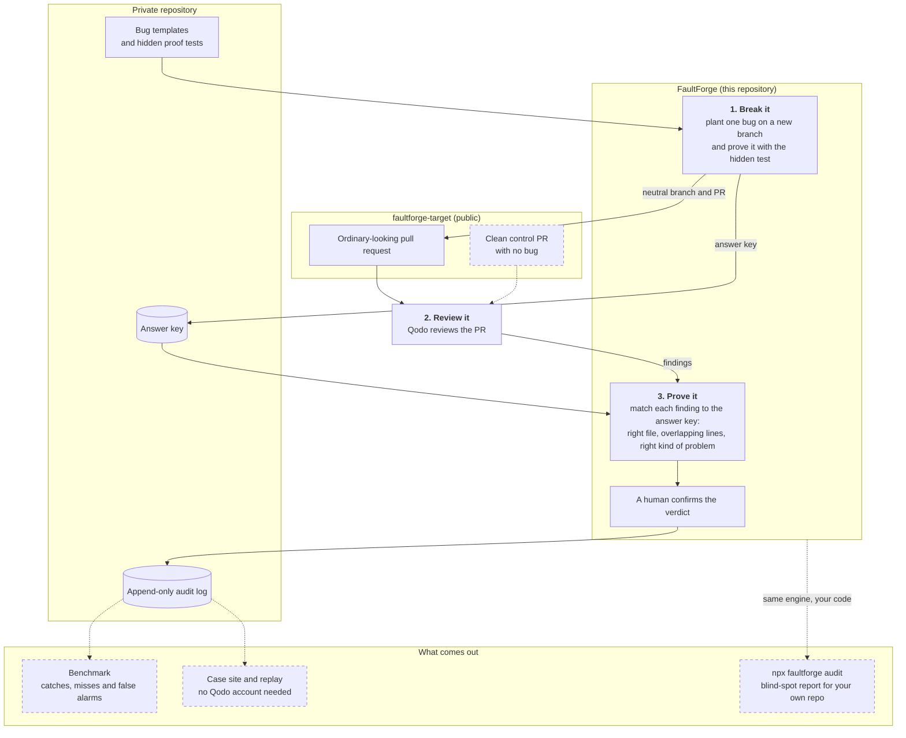

# FaultForge

**Break it. Review it. Prove it.**

An adversarial quality lab for AI software factories, powered by [Qodo](https://www.qodo.ai/).

Built for the Qodo hackathon *Build a Software Factory in 30 Days* (November 2026).

---

## Why

Coding agents write code faster than anyone can read it, so we lean on AI code review. But how good is that review on *your* codebase, for *your* kinds of bugs? Most of us are guessing.

FaultForge replaces the guessing with evidence.

## How it works

1. **Break it.** A saboteur injects a realistic bug into a TypeScript codebase using deterministic templates: a removed guard clause, a flipped comparison, a missing auth check, a broken idempotency check.
2. **Review it.** The change goes out as an ordinary-looking pull request, and Qodo reviews it.
3. **Prove it.** The answer key lives in a private ledger outside the repository, so the reviewer never gets a hint. Every finding is matched against it with a fixed rule: right file, overlapping lines, right kind of problem.

Every case is written to an append-only log, and every number in a report can be traced back to it. Clean control PRs with no injected bug will go through the same pipeline, so false positives are measured too, not just catches.



Solid boxes work today; dashed boxes are planned. Qodo is connected only to the target repository. The answer key and the audit log stay private. A template is published here only after its case has been adjudicated.

## Where it is going

By the end of the month:

- **For your own project:** run one command and get a blind-spot report showing the bugs that would get past both your test suite and your reviewer.

  ```bash
  npx faultforge audit
  ```

- **For judges and visitors:** browse every real case online, or open the repo in a Codespace and replay the full pipeline without needing a Qodo account.
- **A benchmark** with real counts and defined denominators: what Qodo caught, what it missed, and why.

Halfway through the month, the factory gets a new member that doesn't trust anyone: **Devil's Advocate**, which tries to support or disprove each Qodo finding by writing and running a test. The full plan is in the [charter](docs/CHARTER.md) and the [tickets](https://github.com/AJBeumer/faultforge/issues).

## Principles

- **Proof over opinion.** A model saying "looks fine" is not evidence. A test is.
- **The answer key stays hidden.** Ground truth never enters the reviewer's context.
- **Sabotage looks ordinary.** PR titles and commit messages never give the bug away.
- **Only measured numbers.** No simulated results, ever. Misses get published too.
- **Qodo is the reviewer, not the target.** FaultForge measures and extends review. It does not replace it.

## Status

| Day | Milestone | State |
|---|---|---|
| 1 | Booking API, first injected bug, first Qodo review (case FF-0001) | Done: Qodo caught it ([PR #1](https://github.com/AJBeumer/faultforge-target/pull/1), [case record](examples/FF-0001.json)) |
| 2 | House rules: target `AGENTS.md` imported as Qodo review standards (configuration v3) | Done ([PR #2](https://github.com/AJBeumer/faultforge-target/pull/2)) |
| 3 | Backlog as [GitHub Issues](https://github.com/AJBeumer/faultforge/issues) and a [project board](https://github.com/users/AJBeumer/projects/6); three target tickets delivered one by one, each reviewed by Qodo (configuration v4) | Done ([#6](https://github.com/AJBeumer/faultforge-target/pull/6), [#8](https://github.com/AJBeumer/faultforge-target/pull/8), [#9](https://github.com/AJBeumer/faultforge-target/pull/9)) |
| 4 to 14 | Verify Qodo's structured review output, more bug templates, control PRs, first measured baseline | Planned |
| 15 | Devil's Advocate challenges its first real Qodo finding with a test | Planned |
| 16 to 30 | Evidence, replay, one-command audit, final benchmark | Planned |

Progress and decisions for each daily challenge are recorded in [docs/decision-log.md](docs/decision-log.md).

## Repositories

- **FaultForge** (this repository): the harness, tooling, reports, and documentation.
- **[faultforge-target](https://github.com/AJBeumer/faultforge-target)**: the small booking API that gets attacked and reviewed. It is kept separate so the answer key never sits next to the code Qodo reviews.
- **A private repository** holds the answer key, raw reviewer output and unreleased bug templates. Templates are published here only after their case has been reviewed and adjudicated.

## Try it

Requires Node.js 22 or later.

```bash
npm install
npm run check      # typecheck, lint and tests
```

Planting a bug needs a checkout of [faultforge-target](https://github.com/AJBeumer/faultforge-target) next to this repository:

```bash
npm run inject -- --template idempotency-guard-bypass-v1 --target ../faultforge-target --case FF-0001
```

The command applies the template on a new branch in the target, runs the hidden proof test before and after, and keeps the change only if the test proves the bug. It writes the answer key to a local `private/` folder, which git ignores. A one-command audit for your own repository is planned (see Status).

## Repository layout

| Path | Contents |
|---|---|
| `packages/harness/` | The inject command and its checks |
| `templates/seed/` | Bug templates and proof tests, published after their case is adjudicated |
| `docs/decision-log.md` | One entry per daily challenge: decisions, results, lessons |
| `CLAUDE.md`, `.claude/` | Rules and tooling for the coding agent that helps build this project, including a hook that blocks hints from reaching the target repository |

## Stack

TypeScript, Node.js, Fastify, Vitest, Biome, Qodo. Built with Claude Code as the coding agent. Plain scripts and a small CLI. No agent framework.
