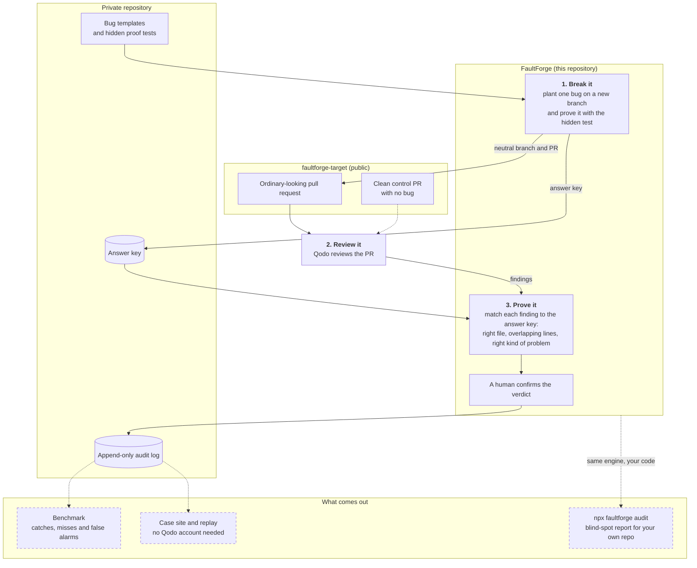

# How the parts fit

Part of the [docs](../README.md). Moved here from the [project README](../../README.md).

Solid boxes work today; dashed boxes are planned. Qodo reviews both repositories; the two are not linked to each other in Qodo. The answer key and the audit log stay private. A template is published here only after its case has been adjudicated.

## Repositories

- **FaultForge** (this repository): the harness, tooling, reports, and documentation.
- **[faultforge-target](https://github.com/AJBeumer/faultforge-target)**: the small booking API that gets attacked and reviewed. It is kept separate so the answer key never sits next to the code Qodo reviews.
- **A private repository** holds the answer key, raw reviewer output and unreleased bug templates. Templates are published here only after their case has been reviewed and adjudicated.

## Repository layout

| Path | Contents |
|---|---|
| `packages/harness/` | The inject command, the review capture, the factory runner and their checks |
| `templates/seed/` | Bug templates and proof tests, published after their case is adjudicated |
| `examples/` | Sanitized public case records, published after their case is adjudicated |
| `schemas/` | JSON Schemas for the case record (v1 and v2), the answer-key entry, the audit event, the saved review, the bug template and `factory.json` |
| `factory.json` | The two repositories the factory works in, described once |
| `docs/README.md` | The docs' start page: every document, one line each |
| `docs/CHARTER.md` | The plan: goals, principles, method, roadmap |
| `docs/decision-log.md` | The decision log's index: one entry per daily challenge, plus dated decisions and corrections, kept by week under `docs/decisions/` |
| `docs/ledger-anchors.txt` | Commit ids of the private history, so a rewrite of it is detected |
| `CLAUDE.md`, `.claude/` | Rules and tooling for the coding agent that helps build this project, including a hook that blocks hints from reaching the target repository |
