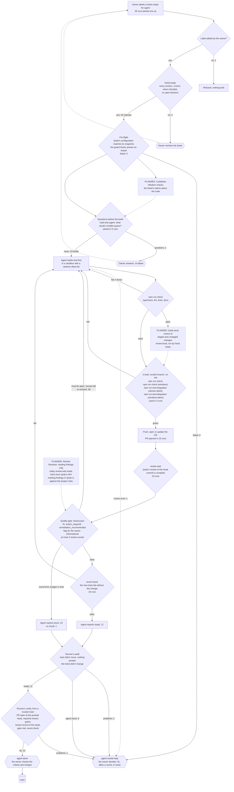

# The factory, drawn from its own data

Generated by `npm run factory:diagram` from 30 lab run records, `20261109-082907-faultforge-66` to `20261118-214605-faultforge-404` (2026-11-09 to 2026-11-18, UTC), and `factory.json`. Do not edit by hand; run the command again.
Each number counts runs, except "fail" and "re-reviews", which count events. Dashed steps are not part of the factory's runs today.
No run record was skipped.

## The gates

| Gate | What must pass | Evidence it reads | When it fails |
|---|---|---|---|
| Label | The owner added `ready-for-agent` | The issue's label events | Refused, nothing built |
| `ticket:ready` | Every required section, a checklist, no open blockers | The ticket | Back to the owner |
| Pre-flight | Qodo's configuration is the recorded one; the guard hooks answer as tested | `qodo:check`, a hook self-test | The run stops |
| Questions | No question a builder would have to guess | A read-only agent's answer | Questions posted; the owner answers |
| `npm run check` | Typecheck, lint, tests, docs | The command's exit code | Back to the build |
| `ci:wait` | `npm run check`, `npm run check (windows)`, `npm run test:integration (ubuntu-latest)`, `npm run test:integration (windows-latest)` | The jobs' results on a scratch branch | Back to the build, no review round spent |
| `review:wait` | Qodo's review of the head commit is complete | Qodo's API | No verdict until it is |
| Quality gate | Nothing open labelled `action_required` or `remediation_recommended`, within 3 rounds | Qodo's saved record of the head | A fix round, or stuck at the limit |
| `revert:check` | The new tests fail without the change | The tests run on the base | Back to the build |
| Audit | `main` didn't move, nothing was posted, the ticket didn't change | GitHub's history for the run's window | `agent-needs-help` |
| Verify | All of the above, rechecked by the runner from a trusted `main` | GitHub and the saved records | `agent-needs-help` |
| Merge | The owner's decision | The PR and its evidence | The owner sends it back |

## Where runs stopped

10 of 30 runs ended as `agent-done`. The others stopped at one place each, the first the runner reports.

| Stopped at | Runs |
|---|---:|
| label check | 1 |
| ticket:ready | 4 |
| questions before the build | 2 |
| agent's own loop | 9 |
| runner's audit | 2 |
| runner's verify | 1 |
| runner error | 1 |

Every stopped run:

| Run | Stopped at | Reason |
|---|---|---|
| `20261109-082907-faultforge-66` | ticket:ready | missing section "Done when"; missing section "Must not break" |
| `20261109-094924-faultforge-71` | label check | label added by github-actions[bot], not the owner AJBeumer |
| `20261110-114122-faultforge-107` | runner's audit | the run's audit found: main of faultforge moved (8fd9b56 → f37f85c); main of the private repo moved (9fd13a8 → f0ec214); a comment was posted during the run (ht |
| `20261110-145440-faultforge-18` | ticket:ready | missing section "Must not break" |
| `20261110-150249-faultforge-18` | agent's own loop | the agent ended without a result, exit code 0 |
| `20261110-174918-faultforge-10` | agent's own loop | PR is built, reviewed clean (no action-required findings open), and live-checked, but npm run revert:check exits 2 (can't judge) because the package.json diff ( |
| `20261110-183447-faultforge-19` | agent's own loop | PR 137 is built, reviewed clean by round 2, and live-checked, but npm run revert:check exits 2 (package.json's new script line looks like an unprovable dependen |
| `20261110-203734-faultforge-11` | agent's own loop | The three-review-round limit was reached while one more necessary fix (making the new integration test skip instead of fail when private/ isn't checked out, nee |
| `20261110-220732-faultforge-102` | agent's own loop | Three Qodo review rounds used (0 new findings on the final head commit), but one action_required finding from round 1 remains open overall: full durability of t |
| `20261111-170834-faultforge-4` | ticket:ready | blocked by open tickets #108 |
| `20261111-210432-faultforge-8` | ticket:ready | missing section "Must not break" |
| `20261111-211249-faultforge-8` | agent's own loop | After three review rounds an action-required Qodo finding is still open (.claude/skills/new-case/SKILL.md has stale stop-and-ask branch guidance) which this una |
| `20261111-213509-faultforge-12` | runner's audit | the run's audit found: main of faultforge moved (3632b7a → f14a2a9) |
| `20261111-230740-faultforge-101` | agent's own loop | Three review rounds left one action-required Qodo finding open (an agent could forge verification by tampering with revert:check's own source or trusting a bare |
| `20261112-153917-faultforge-161` | runner error | gh repos/AJBeumer/faultforge/pulls?state=all&sort=updated&direction=desc&per_page=50&page=1 failed: workflow |
| `20261112-195359-faultforge-176` | agent's own loop | Ran out of budget before fixing the 2 open action-required Qodo findings on PR 179 (buildLocalDiff's quoted-header detection only covers the first file, not a l |
| `20261116-203213-faultforge-361` | agent's own loop | All of Qodo's findings are fixed (0 open after round 2 and round 3), but the Windows npm run check job is still red from a test-only path-comparison bug, and fi |
| `20261117-222504-faultforge-393` | questions before the build | 2 questions for the owner before building |
| `20261117-222931-faultforge-393` | runner's verify | the agent reported "ready", but checks not green: npm run check (windows) IN_PROGRESS, npm run test:integration (windows-latest) IN_PROGRESS; couldn't save reve |
| `20261118-214104-faultforge-404` | questions before the build | 1 question for the owner before building |
